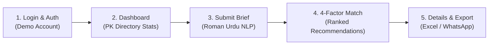

# InfluMatch: A Roman Urdu Aware, Content Grounded Creator Matching Engine for Pakistan

**Final Year Project (FYP) Demonstration Prototype**  
Developed for Brand Managers, PR Agencies, and Evaluators to demonstrate grounded influencer matching using Pakistani vernacular text processing and transparent 4-factor fit scoring.

---

## 📌 System Overview

**InfluMatch** solves the disconnect between unstructured, multilingual influencer marketing briefs in Pakistan and creator discovery. Brand and agency professionals in Pakistan frequently express requirements in **Roman Urdu** (e.g., *"Hum Karachi mein apni new skincare brand launch kar rahe hain..."*), a dialect unsupported by traditional global marketing platforms.

InfluMatch introduces:
1. **Roman Urdu & Vernacular NLP Parser:** Extracts campaign categories, sub-niches, target personas, cities, platforms, content tones, and seasons from free-text briefs.
2. **Transparent 4-Factor Fit Scoring:** Replaces crude follower-count sorting with a multidimensional scoring formula:
   $$\text{Overall Fit Score} = (0.40 \times \text{Topical Fit}) + (0.25 \times \text{Community Fit}) + (0.20 \times \text{Style Fit}) + (0.15 \times \text{Commercial Fit})$$
3. **Feature-Grounded Explanations (TreeSHAP Architecture):** Generates explainable, verifiable justifications for why each creator was recommended.
4. **Interactive Constraint Relaxation:** Advises the user when filters are overly strict, demonstrating how relaxing geographic or platform constraints unlocks high-affinity creators.
5. **Multi-Channel Export:** One-click Excel report generation and WhatsApp-formatted shortlist sharing.

---

## ⚡ Quick Start (Windows Installation & Execution)

### Step 1: Prerequisites
- **Python 3.11+** installed on Windows.
- Make sure Python is added to your Windows `PATH`.

### Step 2: Open Terminal / Command Prompt
Navigate to the project root directory:
```powershell
cd c:\Users\shahz\OneDrive\Desktop\frontend
```

### Step 3: Install Dependencies
Install all required libraries locally:
```powershell
pip install -r requirements.txt
```

### Step 4: Run the Application
Launch the Streamlit prototype:
```powershell
streamlit run app.py
```
Streamlit will automatically launch the application in your default browser at `http://localhost:8501`.

---

## 🔑 Demonstration Credentials

For live FYP presentations and evaluator testing, use the pre-seeded agency account:

| Parameter | Demonstration Value |
| :--- | :--- |
| **Email** | `demo@brandagency.pk` |
| **Password** | `demo123` |
| **User Name** | Sarah Ahmed |
| **Agency** | Zenith PR & Brand Agency |

*(Note: Credentials can be entered into the login form or you may create a new account.)*

---

## 🚀 FYP Demonstration Walkthrough

During your presentation, follow this 5-step journey to demonstrate all system capabilities:



### 1. Page 1: Agency Login (`app.py`)
- Log in with `demo@brandagency.pk` / `demo123` or register a new user.
- Highlights prototype SQLite authentication and session protection.

### 2. Page 2: Dashboard (`pages/1_Dashboard.py`)
- Displays statistics of the 36 fictional Pakistani creators.
- Visualizes niche distributions and geographic spread across Pakistani cities (Karachi, Lahore, Islamabad, Multan, Rawalpindi, etc.).
- Explains the 4-step matching pipeline.

### 3. Page 3: Create Campaign (`pages/2_Create_Campaign.py`)
- Type or paste your campaign brief in Roman Urdu or English.
- Adjust target platforms, cities, follower tiers, and tone.
- Click **"Find Matching Creators"** to trigger the NLP lexicon parser and scoring engine.

### 4. Page 4: Matching Results (`pages/3_Matching_Results.py`)
- **NLP Parameter Summary:** Demonstrates extraction of category, sub-niche, persona, and Roman Urdu lexical anchors.
- **Constraint Relaxation:** If filters are tight, shows instant count impact of expanding city or platform constraints.
- **Top 10 Creator Cards:** Displays overall fit score badge and individual horizontal progress bars for:
  - Topical Fit (40%)
  - Community / Persona Fit (25%)
  - Style & Tone Fit (20%)
  - Commercial Tier Fit (15%)
- Export results via **"Download Excel Report"** (`.xlsx`) or **"WhatsApp Shortlist Text"**.

---

## 📝 Pre-Loaded Roman Urdu Test Briefs

You can use these realistic briefs during your evaluation:

### Brief 1: Skincare Launch in Karachi (Roman Urdu)
> *"Hum Karachi mein apni new skincare brand launch kar rahe hain. Humein aise influencers chahiye jo skincare, beauty aur self-care content banate hon. Audience mostly young females honi chahiye. Budget limited hai aur humein micro influencers prefer hain."*
- **Matched Creator:** Aiman Glow Diaries (`@aiman.glowdiaries`) - Micro Skincare Creator, Karachi.

### Brief 2: Lahore Street Food & Ramadan Campaign (Roman Urdu)
> *"Lahore mein hamara new desi food restaurant open ho raha hai. Ramadan ke liye sehri aur iftar deals promote karni hain. Humein foodies aur desi khana vloggers chahiye jo entertaining aur casual style mein review dein."*
- **Matched Creator:** Chef Adeel Kitchen (`@chefadeelpk`) / Karachi Food Hunt.

### Brief 3: Budget Smartphone Launch in Twin Cities (Mixed Language)
> *"We are releasing a budget 5G phone under 45k PKR in Pakistan. Humein Rawalpindi aur Islamabad ke tech reviewers chahiye jo informative pubg gaming tests aur camera reviews banayein."*
- **Matched Creator:** TechTalk Bilal (`@techtalkbilal`) / Usman Tech Studio.

---

## 🏗️ Project Architecture & Modular Design

```
influMatch/
│
├── app.py                      # Login / Auth / App Router (Page 1)
├── config.py                   # Central settings, colors, weights, taxonomy
├── requirements.txt            # Python package dependencies
├── README.md                   # Installation & demonstration guide
├── test_system.py              # Automated verification test suite
│
├── pages/
│   ├── 1_Dashboard.py          # Dashboard overview & statistics (Page 2)
│   ├── 2_Create_Campaign.py    # Roman Urdu brief submission form (Page 3)
│   ├── 3_Matching_Results.py   # Ranked recommendations & details (Pages 6, 7, 8, 10)
│   └── 4_Campaign_History.py   # Historical searches from SQLite (Page 9)
│
├── modules/
│   ├── authentication.py       # Session state and login/signup handlers
│   ├── brief_parser.py         # Roman Urdu lexical keyword & semantic parser
│   ├── creator_matcher.py      # Hard filtering & constraint relaxation engine
│   ├── scoring.py              # 4-factor scoring & scikit-learn TF-IDF engine
│   ├── explanations.py         # Feature-grounded explainability (TreeSHAP proxy)
│   ├── data_loader.py          # Creator dataset loading and cache management
│   ├── export.py               # Excel (.xlsx) and WhatsApp text generator
│   └── ui_components.py        # Clean corporate CSS styles, badges & layout helpers
│
├── data/
│   ├── creators.csv            # 36 fictional Pakistani creators dataset
│   └── create_sample_creators.py # Dataset generation script
│
└── database/
    ├── db.py                   # SQLite schema, users table, and campaign audit log
    └── influmatch.db           # SQLite database file
```

---

## 🔬 Mathematical 4-Factor Scoring Model

All individual dimensions are normalized on a $[0, 100]$ scale:

1. **Topical Fit ($S_{\text{topical}}$):**
   Combines primary niche alignment + TF-IDF cosine similarity between the campaign brief corpus and creator captions + keyword overlap bonus.
2. **Community / Persona Fit ($S_{\text{community}}$):**
   Evaluates target audience demographic overlap (gender, student/working segments) and geographic city proximity.
3. **Style & Tone Fit ($S_{\text{style}}$):**
   Evaluates alignment between requested content tone (Friendly, Informative, Humorous, etc.), language delivery (Roman Urdu vs English), and seasonality context.
4. **Commercial Tier Fit ($S_{\text{commercial}}$):**
   Measures step distance between requested creator tier (Nano, Micro, Mid, Macro, Mega) and budget preference tier (Low, Medium, High).

The final score is computed as:
$$\text{Overall Fit} = (S_{\text{topical}} \times 0.40) + (S_{\text{community}} \times 0.25) + (S_{\text{style}} \times 0.20) + (S_{\text{commercial}} \times 0.15)$$

---

## 🔮 FYP Phase 2 Roadmap (Future Integration)

The prototype code has been explicitly modularized to allow drop-in replacement with advanced deep learning models:
- **`modules/brief_parser.py`**: Prepared for fine-tuned **Google MuRIL** (Multilingual Representations for Indian & Pakistani Languages) and **EmbeddingGemma**.
- **`modules/scoring.py`**: Prepared for **LightGBM LambdaMART** learning-to-rank on historical campaign CTR/conversion datasets.
- **`modules/explanations.py`**: Prepared for **TreeSHAP** exact Shapley values computed across gradient boosted tree ensembles.

---

## ⚖️ Academic Prototype Disclaimer
This software is a functional prototype built for an academic Final Year Project demonstration. The creator dataset is fictional and intended purely for system validation and performance evaluation.
